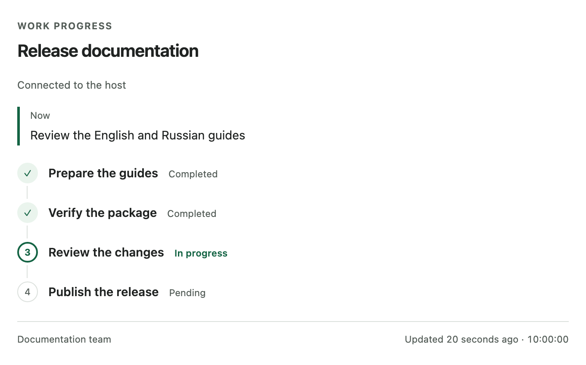

# codex-progress-panel

[English](README.md) | [Русский](README.ru.md)

A lightweight progress panel for OpenAI Codex. See what the agent is doing, what it has completed, what remains, and how parallel agents and task requirements change during the work.



The current panel component with illustrative English task data. This preview does not prove native Codex rendering or placement.

## Features

- **Task stages:** see pending, active, completed and blocked work.
- **Parallel agents:** see short agent summaries under their stage.
- **Plan changes:** keep the same panel when the agent reconciles changed requirements; retain confirmed progress and retired-stage history.
- **Local persistence:** keep execution state across server restarts.
- **Final snapshots:** successful finalization freezes each execution's history.
- **Freshness:** see the last confirmed update and a stale indication after two minutes without one.
- **Local operation:** no telemetry, network listener, remote assets or background daemon.

The panel displays progress reported by the agent. It does not independently verify that code is correct.

## Install the complete plugin

Install the complete plugin, including its skill, MCP server and UI integration, directly from GitHub:

```sh
codex plugin marketplace add Karikatun/codex-progress-panel
codex plugin add codex-progress-panel@codex-progress-panel --json
```

Start a new chat, then ask: “Show the stages of this task in the progress panel and keep them updated as you work.”

The marketplace tracks `main`, which can change. Pin a reviewed Git ref with `--ref` if you need a fixed source revision. For example, `codex plugin marketplace add Karikatun/codex-progress-panel --ref main` selects the current branch. GitHub currently lists no version tags or Releases.

On 2026-10-12, we tested the GitHub install with Codex CLI `0.147.0` in a fresh isolated `CODEX_HOME`. GitHub `main` resolved to reviewed commit `2915a86a1bf758cbf4b4664430025a81795fec50`; the marketplace and installed plugin matched the reviewed source. The test did not change global Codex configuration. Native desktop rendering remains unverified, and `0.147.0` is not a minimum version requirement. See [installation](docs/installation.md) for local-source and standalone alternatives, updating and removal.

The full plugin requires macOS or Linux, Python 3.9+ as `python3` in PATH, and a Codex host that supports plugins, plugin-relative MCP `cwd` and MCP Apps UI.

Source manifests and the public npm package are `0.2.0`. On 2026-10-12, npm `latest` was `0.2.0`. [Distribution status](docs/installation.md#distribution-status) lists the evidence.

## Start using it

Ask Codex in the new chat:

> Show the stages of this task in the progress panel and keep them updated as you work.

You can refine the active task, for example:

> Add a check for the export format and update the remaining stages.

The root agent reconciles the plan and reports progress. The panel does not read the conversation automatically or orchestrate subagents.

## Standalone MCP server alternative

Use npm/npx when you need the server separately. It requires Node.js 22+, npm/npx and Python 3.9+ on macOS or Linux.

```sh
npx -y codex-progress-panel@0.2.0 --help
```

Add this stdio entry through your host's supported MCP configuration:

```json
{"mcpServers":{"progress":{"command":"npx","args":["-y","codex-progress-panel@0.2.0"]}}}
```

This starts the standalone MCP server. It does not install the `progress-panel` skill or activate the complete plugin. The server supplies an HTML resource, but UI rendering still requires an MCP Apps host. See [standalone installation](docs/installation.md#use-the-npm-server).

## How it works

The complete plugin bundles a skill, a Python standard-library stdio MCP server and an MCP Apps panel. The root agent sends explicit progress summaries; SQLite stores each execution under its own identity and capabilities. The read-only panel displays those summaries and polls for confirmed updates. Successful `finish_progress` freezes the final snapshot; later executions get separate widgets.

## Requirements and limitations

- Windows is unsupported; private storage relies on POSIX ownership and permissions.
- The host controls rendering, placement and accessibility. Native `0.2.0` acceptance remains unverified here; protocol and mock UI tests are separate evidence.
- Completed stages do not prove successful execution finalization. A Stop action or crash before successful finish can leave a snapshot unfinished.
- Stale means no recent confirmed update. It does not prove that the agent failed or stopped.
- State is private and local at `~/.codex-progress-panel/progress.sqlite3`. Automatic cleanup is off by default; history is limited to 128 executions.

English UI labels are the default; Russian labels are configurable. Task summaries keep their supplied language. See [configuration](docs/configuration.md) for language, storage and limits, and [limitations](docs/limitations.md) for unsupported and deferred behavior.

## Documentation

- [Installation](docs/installation.md) — complete plugin, standalone server, updates and removal.
- [Architecture and security](docs/architecture.md) — MCP Apps lifecycle and trust boundaries.
- [Protocol](docs/protocol.md) — tools, revisions, recovery, agents and plan changes.
- [Configuration](docs/configuration.md) — UI language, storage, limits and server flags.
- [Development](docs/development.md) — tests, measured overhead, packaging and native acceptance.
- [Limitations](docs/limitations.md) — supported behavior and deferred proposals.

Technical references are in English. [PRODUCT.md](PRODUCT.md) and [DESIGN.md](DESIGN.md) describe product and design constraints, including proposals that are not implemented.

## License

[MIT](LICENSE), copyright 2026 Karikatun.
